<a href="https://github.com/SamuelVendrame/SamuelVendrame/blob/main/README.pt-BR.md">🇧🇷 Português</a> · 🇺🇸 English

 

---

### 👋 About me

Hey there! I'm Samuel, a 20-year-old full stack developer from Paraná, Brazil. I like working across the whole stack, from database queries to the details of a UI, and I'm always looking for ways to ship cleaner, more reliable software. Lately that means bringing AI into my workflow and figuring out where it actually helps.

- 💼 **Full Stack Developer** at **Livreria - Magna Opera** (remote)
- 🏛️ Previously a full stack intern at the **São Manoel do Paraná City Hall**, where I built the municipal cemetery records system and the **AVALIE** platform (.gov.br)
- 🎓 Studying **Systems Analysis and Development** at UMFG (graduating 2027)
- 🌎 Portuguese (native) · English (C1) · French (A2)

---

### 🌱 Currently

- 🤖 Getting better at using AI in my dev workflow
- 🇫🇷 Learning French

---

### 🎧 Now playing

---

### 🛠️ Stack

**Front-end**
 

**Mobile**
 

**Back-end & data**
 

**Testing**
 

**Tools**
 

---

### 🤖 AI

I use AI both in how I build software and inside the products I ship.

**In my workflow**

- 🧭 **Spec-driven development** with GSD: the spec comes first, then execution, then verification
- ✅ **Verification agent** I built that checks each task against its scope and business rules (with an optional security pass) and writes manual test scripts before anything ships
- 🎨 **Screen prototyping** with Claude Artifacts, validated with management before coding
- ⚙️ **Automation flows** in n8n integrated with the company ERP

**In products**

- 🏛️ **AVALIE** · two-layer pipeline on the Groq API: real-time comment moderation and batch summaries with sentiment analysis
- 🧠 **Revisa AI** · generates multiple-choice options and grades open answers from 0 to 10, with a pluggable AI provider and a fake one so tests run without an API key
- 📚 **Book cover generator** · an agent that creates the art, reviews its own result and retries with a corrected prompt up to 3 times

---

### 🚀 Featured projects

#### 🧠 Revisa AI · private code

Turns slides and PDFs into flashcards and grades your answers with AI: multiple choice with AI-generated options, or exam mode with a 0–10 score and what was missing. Spaced repetition (SM-2), study heatmap and PDF export. Monorepo with a NestJS API, Next.js web app and Expo mobile app.

#### 🛒 [Kurio](https://github.com/SamuelVendrame/teste-tecnico-jungle) · [live demo](https://teste-tecnico-jungle.vercel.app)

Full NFT marketplace built as a technical test: catalog, cart, checkout, collector account and real-time updates. REST API and Socket.IO mocked in the browser with MSW across 12 scenarios (slow network, expired session, declined payment, price changing mid-checkout), idempotent orders, and Playwright E2E + visual regression tests in CI.

#### 🗓️ [Grade Fácil](https://github.com/SamuelVendrame/grade-facil) · open source · [live demo](https://samuelvendrame.github.io/grade-facil/)

Plan your college courses on a kanban board and automatically generate every class schedule with no time conflicts, ranked by fewest days on campus and fewest gaps. Exports to PDF.

#### 💬 [Chat Web](https://github.com/SamuelVendrame/projeto-webchat) · open source

Real-time chat with an Express + WebSocket backend and a React + TypeScript + Tailwind client, served from a single server in production.

 

