🇧🇷 Português · <a href="./README.md">🇺🇸 English</a>

 

---

### 👋 Sobre mim

Oi! Sou o Samuel, dev full stack de 19 anos do Paraná. Gosto de trabalhar em todas as camadas — das queries no banco aos detalhes de uma interface — e estou sempre buscando jeitos de entregar software mais limpo e confiável. Ultimamente isso passa por trazer IA pro meu fluxo de trabalho e descobrir onde ela realmente ajuda.

- 💼 **Full Stack Developer** na **Livreria – Magna Opera** (remoto)
- 🏛️ Antes disso, estagiário full stack na **Prefeitura de São Manoel do Paraná**, onde construí o sistema de registros do cemitério municipal e a plataforma **AVALIE** (.gov.br)
- 🎓 Cursando **Análise e Desenvolvimento de Sistemas** na UMFG (previsão: 2027)
- 🌎 Português (nativo) · Inglês (C1) · Francês (A2)

---

### 🌱 No momento

- 🤖 Melhorando meu uso de IA no desenvolvimento
- 🇫🇷 Aprendendo francês

---

### 🎧 Tocando agora

---

### 🛠️ Stack

**Front-end**
 

**Back-end & dados**
 

**Ferramentas**
 

---

### 🚀 Projeto em destaque

#### 💬 [Chat Web](https://github.com/SamuelVendrame/projeto-webchat)

Chat em tempo real com backend em Express + WebSocket e client em React + TypeScript + Tailwind, servidos por um único servidor em produção.

 

